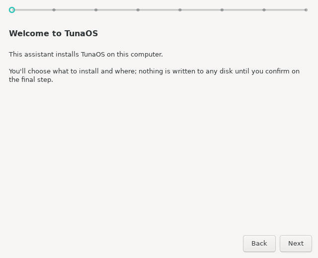

# TunaOS XFCE Installer — GTK3 frontend for fisherman

<p align="center">
  
</p>

<p align="center">
  <em>Every frame is generated in CI from the real wizard — see the
  <a href="docs/gui-walkthrough.md">step-by-step walkthrough</a>.</em>
</p>

Classic GTK3/PyGObject wizard that drives the
[fisherman](https://github.com/projectbluefin/fisherman) bootc install
backend. The plainest of the TunaOS installer frontends by design — see
`DESIGN.md` (the trawl line is the entire brand budget) and the shared
[installer frontend contract](https://github.com/tuna-os/tunaos/blob/main/docs/INSTALLER-FRONTENDS.md).

## Flow

Welcome → Source (image catalog, offline badges, live-ISO self-install) →
Destination → Filesystem & encryption → Identity → Confirm → Progress → Done.

Offline installs: detects live-ISO mode via `bootc status` (empty `image` in
the recipe installs the running system) and probes embedded OCI stores
(`/etc/tuna-installer/offline-stores`, `$TUNA_OFFLINE_STORES`,
`/usr/share/tuna-installer/oci-store`), passing them as
`additionalImageStores`.

## Run (development)

```bash
# Dependencies (Fedora)
sudo dnf install -y python3-gobject gtk3

TUNA_INSTALLER_DRY_RUN=1 ./tuna-installer-xfce
```

> **Always set `TUNA_INSTALLER_DRY_RUN=1` when developing.** Reaching the
> progress page starts the install immediately, with no further confirmation,
> and that partitions the selected disk. With the variable set (any non-empty
> value other than `0`) the wizard behaves normally but never launches
> fisherman: the progress page plays a canned transcript and completes.

Outside a Flatpak a real install invokes `sudo /usr/local/bin/fisherman`.
Inside a Flatpak it runs `flatpak-spawn --host pkexec /usr/local/bin/fisherman`,
so the host must provide that path (the live ISO symlinks the bundled
fisherman there) and the polkit action `org.tunaos.Installer.install`
(installed by the ISO build).

## Tests

The unit tests cover `core.py` and `readiness.py`, need no GTK and run
headlessly:

```bash
python3 -m pip install pytest
python3 -m pytest tests
```

The screenshot capture (`tests/gui/capture-screens.py`) needs GTK3 and Xvfb;
see [docs/gui-walkthrough.md](docs/gui-walkthrough.md#regenerating-these).

## Flatpak

```bash
flatpak-builder --user --install --force-clean build \
  flatpak/org.tunaos.InstallerXfce.json
flatpak run org.tunaos.InstallerXfce
```

Runtime is `org.gnome.Platform` (ships GTK3 + PyGObject; the app uses no
libadwaita and follows the system GTK theme).

## License

GPL-3.0-only
